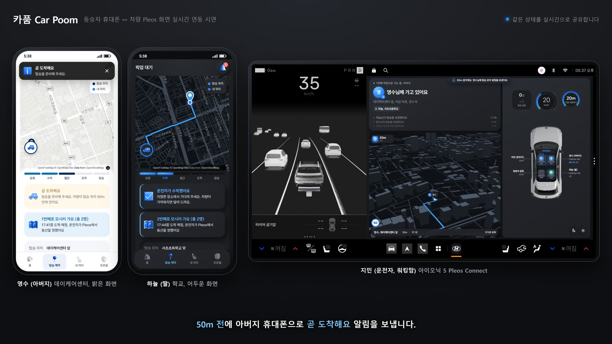

# 카품 (Car Poom)


카품(Car Poom)은 **동승자의 탑승 예약과 개인별 차량 설정을 연결하는 서비스**로, 티키타카(TikiTa_Car) 팀이 현대자동차그룹 차량용 앱 개발 공모전(Pleos Connect) 출품을 위해 기획하고 개발하였으며 동승자용 모바일 앱과 운전자용 차량 앱으로 구성됩니다.

동승자가 탑승 전에 모바일 앱에서 탑승 위치, 시간, 희망 좌석과 개인 설정을 등록하면, 운전자는 차량 화면에서 요청을 확인하고 픽업 순서와 좌석을 배정합니다. 탑승한 뒤에는 확인된 좌석에 개인 설정을 적용해 픽업 준비부터 탑승 환경 조정까지 하나의 흐름으로 이어지도록 했습니다.

이 저장소는 이 과정을 바로 시연할 수 있도록 **웹과 안드로이드 앱으로 구현해 두었습니다**. 안드로이드 기기에서는 `apk/` 폴더의 APK를 설치해 모바일 앱과 차량 앱을 실행하고(차량 앱은 Pleos Connect Emulator v2.1.0에서 구동을 확인했습니다), 브라우저에서는 `dist/stage.html`을 열어 두 화면이 연동되는 과정을 시연할 수 있습니다. 실제 차량 제어와 Pleos SDK 연동은 다음 개발 단계에서 진행하며, 지금 화면에 표시되는 차량 상태와 설정 적용 결과는 시뮬레이션입니다.

| 항목       | 내용                                                                                                                    |
| ---------- | ----------------------------------------------------------------------------------------------------------------------- |
| 앱 이름    | 카품 (Car Poom)                                                                                                         |
| 한 줄 소개 | 동승자의 탑승 예약과 개인별 차량 설정을 연결하는 픽업 서비스                                                            |
| APK        | [`apk/티키타카_카품_release.apk`](apk/티키타카_카품_release.apk) (release 버전, Android 9 이상)                         |
| 실행 방법  | [4. 시연 실행 방법](#4-시연-실행-방법) 참고. 브라우저에서는 [`dist/stage.html`](dist/stage.html)을 열면 바로 시연됩니다 |
| 시연 영상  | [YouTube에서 보기](https://www.youtube.com/watch?v=GADchNKkOeY)                                                         |

## 1. 기획 목적 및 이용 대상

가족이나 지인을 태울 때 운전자는 탑승 위치와 시간을 확인해야 하고, 탑승 후에는 좌석이나 공조 설정 요청에도 대응해야 합니다. 동승자 역시 자신의 선호를 매번 말로 전하거나 차에 탄 뒤 설정을 다시 맞춰야 하는 불편이 있습니다.

카품은 탑승에 필요한 정보와 개인 설정을 미리 공유해 운전자의 반복적인 확인과 조작 부담을 줄이고, 동승자가 자신의 선호에 맞는 탑승 환경을 미리 준비할 수 있도록 하는 것을 목표로 합니다.

| 항목      | 내용                                                                                    |
| --------- | --------------------------------------------------------------------------------------- |
| 개발 주체 | 티키타카(TikiTa_Car) 팀                                                                 |
| 이용 대상 | 차량 소유자인 운전자와 운전자가 초대한 성인 및 미성년 동승자                            |
| 이용 시점 | 탑승 예약, 픽업 이동, 탑승 확인 및 정차 상태의 설정 적용 단계                           |
| 이용 환경 | 동승자의 모바일 앱과 운전자의 Pleos Connect 차량 앱                                     |
| 주요 기능 | 탑승 예약, 차량별 권한 관리, 픽업 순서 관리, 좌석 배정 및 개인 설정 적용                |
| 이용 방식 | 모바일에서 예약과 설정을 등록하고, 차량 화면에서 픽업 수락, 탑승 확인, 설정 적용을 진행 |

‘카품’은 자동차를 뜻하는 Car와 사람을 감싸 안는 ‘품’을 결합한 이름이고, 엠블럼은 안전벨트를 연상시키는 곡선이 H를 감싸는 형태로 탑승자를 배려하는 서비스의 방향을 표현했습니다.

## 2. 주요 기능 및 화면 구성

### 주요 기능

- **탑승 예약:** 동승자가 지도에서 탑승 위치를 지정하고, 즉시 탑승이나 희망 시간과 좌석을 선택해 요청합니다.
- **차량별 권한 관리:** 운전자가 동승자를 초대해 설정 변경 권한을 부여하며, 성인과 미성년 동승자에게 같은 원칙을 적용해 권한이 없는 동승자의 설정은 운전자가 관리합니다.
- **개인 설정 관리:** 좌석 위치, 등받이, 열선과 통풍, 공조와 창문 설정을 저장해 두고 탑승할 좌석에 연결합니다.
- **픽업 및 좌석 관리:** 운전자가 요청을 수락하고 픽업 순서와 좌석을 배정하면, 차량 화면에서 경로와 탑승 예정 좌석을 함께 확인할 수 있습니다.
- **탑승 확인 및 설정 적용:** 차량 화면에서 탑승자와 좌석을 확인한 뒤 저장된 설정을 적용하며, 현재는 이 과정을 시뮬레이션으로 보여 줍니다.

### 화면 구성

세 화면은 공통 로직인 `carpoom-core.js`를 함께 사용합니다.

| 화면           | 파일           | 주요 역할                                                                       |
| -------------- | -------------- | ------------------------------------------------------------------------------- |
| 모바일 앱      | `carpoom.html` | 탑승 예약, 개인 설정, 동승자 초대 및 권한 관리, Pleos QR 연결                   |
| 차량 앱        | `pleos.html`   | QR 로그인, 픽업 수락 및 순서 관리, 경로 안내, 좌석 배정, 탑승 확인 및 설정 적용 |
| 통합 시연 화면 | `stage.html`   | 동승자 휴대폰 2대와 차량 화면을 함께 띄워 화면 간 연동 과정을 시연              |



왼쪽 두 화면은 아버지와 딸의 모바일 앱이고 오른쪽은 운전자용 차량 화면이며, 시연 영상은 이 통합 시연 화면을 직접 조작하면서 녹화하였습니다.

## 3. 시연 시나리오

퇴근한 운전자가 데이케어센터에 있는 아버지와 초등학교에 있는 딸을 차례로 태운 뒤 귀가하는 상황을 기준으로 구성하였습니다. 배경 지역은 서울 서초동이며, 계정의 인명과 차량 번호는 시연을 위해 만든 가상 정보입니다.

1. 아버지는 모바일 앱에서 즉시 탑승을 요청하고, 딸은 희망 탑승 시간과 뒷좌석을 지정해 요청합니다.
2. 운전자가 차량 화면에서 두 요청을 확인하고 픽업 순서와 좌석을 배정하면, 차량 화면은 지정된 탑승 위치까지 이동하는 과정을 보여 줍니다.
3. 탑승 후에는 차량 화면에서 탑승자와 좌석을 확인하고, 정차한 상태에서 해당 좌석의 개인 설정을 적용합니다.

### 시연 계정 및 권한

| 계정         | 역할         | 차량 12가 3456              | 차량 34나 7890 |
| ------------ | ------------ | --------------------------- | -------------- |
| `u_jimin`    | 운전자       | 차량 소유자                 | 차량 소유자    |
| `u_youngsoo` | 아버지       | 초대 완료, 설정 변경 가능   | 초대되지 않음  |
| `u_haneul`   | 딸, 초등학생 | 초대 완료, 설정 조회만 가능 | 설정 변경 가능 |

두 차량은 같은 사용자라도 차량마다 권한이 다를 수 있다는 점을 보여 주며, 동승자가 설정을 바꿀 수 있는지는 나이가 아니라 해당 차량의 운전자가 준 권한에 따라 정해집니다.

시연 차종은 Pleos Connect Emulator의 기본 차량과 같은 아이오닉 5로 구성했고, 차량 화면의 차량 이미지와 시작 화면 영상은 아이오닉 5 3D 모델을 직접 렌더링해 만들었습니다.

## 4. 시연 실행 방법

### APK로 실행

[`apk/티키타카_카품_release.apk`](apk/티키타카_카품_release.apk)를 안드로이드 기기에 설치하면 실행 아이콘이 두 개 생깁니다. 두 앱은 같은 기기 안에서 상태를 공유하기 때문에, 한 기기에서 모바일 앱과 차량 앱을 오가며 요청과 수락 과정을 이어서 확인할 수 있습니다.

| 아이콘     | 화면                     | 사용자                   |
| ---------- | ------------------------ | ------------------------ |
| 카품       | 모바일 앱, 세로 화면     | 동승자와 운전자의 휴대폰 |
| 카품 Pleos | Pleos 차량 앱, 가로 화면 | 운전자가 보는 차량 화면  |

1. 기기에서 APK 파일을 열어 설치합니다. 처음 설치할 때는 ‘출처를 알 수 없는 앱 설치’를 허용해야 하며, PC에 연결한 기기에는 `adb install apk/티키타카_카품_release.apk`로 설치할 수도 있습니다.
2. **카품 Pleos**를 열고 ‘지민님 휴대폰으로 스캔’을 눌러 차량과 연결합니다.
3. 좌석 패널 오른쪽 아래의 **설정 → 픽업 요청 받기**를 누르면 아버지와 딸의 픽업 요청이 들어오고, 이어서 픽업 수락, 좌석 배정, 길 안내, 탑승 확인 순서로 진행합니다. 같은 설정 창에서 ‘빨리 감기’를 켜면 이동 시간이 짧아집니다.
4. **카품**을 열어 시연 계정(지민, 영수, 하늘)을 고르면, 차량 앱에서 진행한 요청과 수락 상태가 각 계정의 휴대폰 화면에 그대로 표시됩니다.

### Pleos Connect Emulator에서 실행

차량 앱은 Pleos Connect의 앱 창 안에서 실행됩니다. 위쪽 상태 표시줄, 아래쪽 공조 및 앱 막대, 왼쪽 주행 정보 화면은 Pleos 시스템이 표시하므로, 앱은 남은 앱 창을 빈틈없이 채우고 밝은 화면과 어두운 화면에 맞춰 시작 화면 영상을 바꿉니다. 화면 색은 Pleos의 밝게, 어둡게 설정을 따르며 앱을 띄운 채 설정을 바꿔도 바로 반영됩니다.

1. [Pleos Connect Emulator 설치 안내](https://document.pleos.ai/docs/connect/guide/getting-started/application-development/setup-connect-sdk-emulator)에 따라 Android Studio의 SDK Manager에서 Pleos Connect v2.1.0 시스템 이미지를 받고, AVD를 만들어 Cold boot로 실행합니다.
2. `adb install apk/티키타카_카품_release.apk`로 설치한 뒤 앱 목록에서 **카품 Pleos**를 실행합니다.
3. 주행 상태는 Virtual Console로 바꿉니다. `adb forward tcp:8088 tcp:8088`을 실행하고 브라우저에서 `http://127.0.0.1:8088/`을 연 뒤 기어를 D로 두고 속도를 올리면, 왼쪽 주행 정보 화면이 도로와 주변 차량 화면으로 바뀌고 카품은 주행 중에도 그대로 사용할 수 있습니다.
4. Virtual Console에서 좌석 열선, 공조, 창문 값을 바꾸면 Pleos의 아래쪽 막대와 차량 알림에 바로 반영됩니다. 현재 카품은 이 값을 직접 제어하지 않으며, Vehicle SDK 연동 후 같은 항목을 앱에서 적용할 계획입니다.

### 브라우저로 실행

`dist/`에는 브라우저에서 바로 열 수 있는 빌드 결과물이 들어 있어서 별도의 개발 환경을 설치하지 않고도 시연할 수 있습니다.

1. [`dist/stage.html`](dist/stage.html)을 브라우저에서 엽니다.
2. 차량 화면의 **‘지민님 휴대폰으로 스캔’** 버튼을 눌러, 실제 휴대폰 인증을 대신하는 시연용 QR 인증을 진행합니다.
3. 모바일 화면에서 탑승 요청을 등록한 뒤, 차량 화면에서 픽업 수락부터 탑승 확인까지 진행합니다.

개별 화면은 다음 파일로 실행할 수 있습니다.

- 모바일 앱: [`dist/carpoom-standalone.html`](dist/carpoom-standalone.html)
- 차량 앱: [`dist/pleos-standalone.html`](dist/pleos-standalone.html)

지도와 Asta Sans 서체를 불러오려면 인터넷 연결이 필요하며, 오프라인에서는 단순화된 지도와 내장 서체로 대신 표시합니다.

### 실행 옵션

URL 쿼리 매개변수로 시연 계정, 차량, 화면 테마를 지정할 수 있으며 여러 옵션은 `&`로 이어 붙입니다.

| 화면   | 옵션                            | 설명                                                                                     |
| ------ | ------------------------------- | ---------------------------------------------------------------------------------------- |
| 모바일 | `user=u_youngsoo`               | 지정한 계정으로 실행                                                                     |
| 모바일 | `theme=dark` 또는 `theme=light` | 화면 테마 지정                                                                           |
| 모바일 | `nosplash=1`                    | 시작 화면 생략                                                                           |
| 차량   | `vehicle=v_ioniq5b`             | 두 번째 시연 차량 선택                                                                   |
| 차량   | `theme=light`                   | 밝은 화면 테마 적용                                                                      |
| 차량   | `app=1`                         | Pleos 앱 창에 맞춘 화면(APK에서 사용)                                                    |
| 무대   | `frame=../demo/pleos-frame/`    | 에뮬레이터에서 캡처한 Pleos 화면 안에 차량 앱을 넣어 시연(캡처는 저장소에 포함하지 않음) |
| 무대   | `cartheme=light`                | Pleos 틀 모드에서 차량 앱을 밝은 화면으로 표시(라이트 모드 캡처와 함께 사용)             |

예: `carpoom-standalone.html?user=u_youngsoo&theme=light&nosplash=1`

### 테스트 환경 및 필요한 설정

| 실행 방식   | 테스트 환경                                                                    | 확인한 내용                                                                                                       |
| ----------- | ------------------------------------------------------------------------------ | ----------------------------------------------------------------------------------------------------------------- |
| APK, Pleos  | Pleos Connect Emulator v2.1.0(Android 14, API 34, 2560×1440)과 Virtual Console | 앱 창 표시, 시작 화면, 픽업 수락부터 길 안내까지의 흐름, 주행 중(기어 D, 속도 입력) 사용, 밝은 화면과 어두운 화면 |
| APK, 차량   | Android Automotive OS 13 에뮬레이터(x86_64)                                    | 설치와 실행, 차량 연결부터 픽업 수락, 좌석 배정, 길 안내까지의 흐름                                               |
| APK, 휴대폰 | Android 15 에뮬레이터(Pixel 7)                                                 | 두 앱의 실행, 앱 사이의 상태 연동, 밝은 화면과 어두운 화면                                                        |
| 브라우저    | Windows의 Chrome                                                               | `dist/` 화면과 자동 테스트(`npm test`)                                                                            |

- APK는 Android 9(API 28) 이상에서 실행됩니다.
- 지도 타일과 Asta Sans 서체를 불러오기 위해 인터넷 연결이 필요합니다.
- 별도의 회원 가입이나 서버 설정은 필요하지 않으며, 시연 계정과 차량 정보는 앱에 포함되어 있습니다.

## 5. 현재 구현 범위 및 Pleos 연동 계획

현재 구현은 사용자 흐름과 화면 간 상태 연동을 검증하는 데 초점을 맞췄고, 실제 서비스를 개발할 때는 아래 항목을 차량 SDK와 서버에 연결할 계획입니다.

| 항목                   | 현재 웹 구현                                                                    | 후속 연동 계획                           |
| ---------------------- | ------------------------------------------------------------------------------- | ---------------------------------------- |
| 화면 간 상태 공유      | 단일 기기의 브라우저에서 `postMessage`, `BroadcastChannel`, `localStorage` 사용 | 서버를 통한 모바일과 차량 간 상태 동기화 |
| 지도 및 경로           | OpenFreeMap 타일, 사전 저장 경로, OSRM 공개 서버 사용                           | 모바일 지도 SDK 및 Pleos NaviHelper 연동 |
| 차량 위치              | 경로를 따라 이동하는 차량 위치 시뮬레이션                                       | FusedLocation 기반 실제 위치 연동        |
| 좌석 상태 및 설정 적용 | 화면 표시와 상태 변경 시뮬레이션                                                | Vehicle SDK 기반 상태 조회 및 차량 제어  |
| 인증, 알림, 통화       | QR 연결, 본인 및 연령 확인, 알림과 통화의 화면 및 동작 흐름 시연                | 실제 인증, 푸시 알림 및 통화 서비스 연동 |
| 플레이리스트 추천      | 대기 화면에 추천 카드만 표시, 음원 재생 없음                                    | Pleos 음악 앱 연동                       |

### 기능별 SDK/API 활용 계획

현재 웹 구현은 Pleos SDK를 직접 호출하지 않는 대신 차량 화면의 적용 내역에 후속 개발에서 사용할 API를 표시해 두었으며, 실제 연동은 아래 기능을 중심으로 진행할 계획입니다.

| 기능                          | 연동 대상                                                                                      |
| ----------------------------- | ---------------------------------------------------------------------------------------------- |
| 좌석 전후 이동 및 등받이 조정 | Vehicle SDK의 `moveSeatForeAft`, `moveSeatBackrestAngle`, 현재 위치 조회 및 `selectSeatMemory` |
| 좌석 열선 및 통풍             | `setHvacSeatTemperature`, `setHvacSeatVentilation`                                             |
| 공조 설정                     | 차량의 지원 영역에 따른 `setHvacTemperature`, `setHvacFanSpeed`                                |
| 창문 설정                     | `setWindowPosition`                                                                            |
| 좌석 점유 상태 확인           | `registerSeatOccupancy`, `getCurrentSeatOccupancy`                                             |
| 차량별 지원 기능 및 범위 확인 | 기능별 capability 조회 및 `AreaBounds` 확인                                                    |
| 목적지 및 경유지 경로 안내    | NaviHelper의 `requestRouteWithWaypoints` 및 경유지 도착 이벤트                                 |
| 탑승 위치 50m 전 접근 감지    | FusedLocation의 `addProximityAlert`를 활용하고 모바일 알림 서비스와 연결                       |

차량 제어와 위치 및 경로 연동은 [Vehicle SDK](https://document.pleos.ai/docs/pleos-only/connect-sdk-pleos/Vehicle/intro), [NaviHelper](https://document.pleos.ai/docs/pleos-only/connect-sdk-pleos/NaviHelper/route-with-waypoints), [FusedLocation](https://document.pleos.ai/docs/pleos-only/connect-sdk-pleos/FusedLocation/intro) 공식 문서를 기준으로 구체화합니다.

### 연동 시 적용 원칙

- **차량별 지원 여부 확인:** 차량이 제공하는 기능과 조정 범위를 먼저 조회한 뒤 그에 맞는 제어 항목만 활성화합니다.
- **정차 상태에서 설정 적용:** 현재 구현은 정차 후 탑승 확인 단계에서 개인 설정을 적용하고 주행 중에는 좌석 조정을 제한하도록 설계했으며, 실제 차량에 적용할 때는 해당 기능의 API 제약과 권한을 다시 확인합니다.
- **좌석 점유와 탑승자 확인 구분:** 좌석 점유 정보는 사람이 앉아 있는지 확인하는 데에만 쓰고 개인의 신원을 식별하는 정보로 취급하지 않으며, 탑승자와 좌석의 연결은 별도의 확인 절차를 거칩니다.
- **좌석 설정 방식 검증:** 좌석 이동 제어, 현재 위치 조회, 차량 메모리 기능을 활용해 저장된 설정을 적용하는 방식을 검증합니다.
- **경유지 처리:** SDK가 지원하는 경유지 범위를 확인하고, 이를 넘는 픽업은 구간별 경로 요청으로 나눠 처리합니다.
- **개발 및 배포 권한 구분:** 개발 단계에서는 필요한 권한을 선언해 에뮬레이터와 Virtual Console에서 검증하고, 실제 배포 시에는 App Market 심사와 사용 권한 승인 요건을 확인합니다.

## 6. 개발 환경 및 검증 방법

개발 환경은 **Node.js 18 이상**을 기준으로 합니다.

```bash
npm install       # 개발 의존성 설치
npm run build     # dist/ 빌드 결과물 생성
npm test          # 빌드 후 핵심 로직, 모바일 UI, 차량 연동 테스트 실행
npm run video     # 시연 영상 녹화 및 demo/ 저장: ffmpeg 필요
npm run format    # Prettier를 이용한 코드 서식 정리
```

### 테스트 구성

| 명령                 | 검증 범위                                      |
| -------------------- | ---------------------------------------------- |
| `npm run test:core`  | 권한, 예약 상태, 픽업 순서 등 공통 서비스 로직 |
| `npm run test:ui`    | 모바일 앱의 화면 및 사용자 흐름                |
| `npm run test:pleos` | 차량 화면의 동작 및 모바일 화면과의 연동       |

브라우저 테스트는 설치된 Chrome을 Playwright로 실행하며, 기본 탐색 경로와 다른 환경에서는 `PLAYWRIGHT_PATH`와 `CHROME_PATH`로 위치를 지정할 수 있습니다.

영상 녹화에는 ffmpeg가 필요하고, 실행 파일 경로는 `FFMPEG_PATH`로, 시연 화면에 표시할 시각은 `DEMO_TIME`(기본값 `17:37`)으로 지정할 수 있습니다. `demo/pleos-frame/`에 에뮬레이터 화면 캡처가 있으면 차량 앱을 Pleos Connect 화면 안에 넣어 녹화합니다.

### APK 빌드

APK는 `dist/`의 모바일 화면과 차량 화면을 안드로이드 WebView로 감싼 앱이고, 프로젝트는 `android/` 폴더에 있습니다. 빌드에는 JDK 17과 Android SDK(API 35)가 필요합니다.

```bash
npm run build                 # APK에 들어갈 dist/ 화면 생성
cd android
./gradlew assembleRelease     # Windows에서는 gradlew.bat assembleRelease
```

- Android SDK 위치는 `ANDROID_HOME` 환경 변수나 `android/local.properties`의 `sdk.dir`로 지정합니다.
- 서명 정보 파일(`android/keystore.properties`)이 없으면 디버그 키로 서명한 APK가 만들어지며, 저장소에 올린 APK는 팀 서명 키로 서명했습니다.
- 빌드 결과는 `android/app/build/outputs/apk/release/app-release.apk`에 생성됩니다.

## 7. 저장소 구성

```text
├─ carpoom.html        모바일 앱 화면
├─ pleos.html          차량 화면: 기준 해상도 1600×900, 화면 크기에 맞춰 조정
├─ stage.html          모바일 2대와 차량 화면을 연결한 통합 시연 페이지
├─ carpoom-core.js     권한, 설정, 예약, 픽업 순서, 좌석 배정, 탑승 확인 및 QR 로직
├─ carpoom-geo.js      시나리오 위치, 경로, 회전 안내 및 거리 계산
├─ carpoom-sync.js     화면 간 상태 및 차량 위치 동기화
├─ carpoom-brand.js    공통 엠블럼
├─ build.js            단일 HTML 파일 빌드 스크립트
├─ dist/               브라우저에서 바로 실행할 수 있는 빌드 결과물
├─ apk/                제출용 안드로이드 앱(release 버전)
├─ android/            APK 프로젝트: dist/ 화면을 WebView로 띄우는 안드로이드 앱
├─ docs/images/        README 및 시연 설명 이미지
├─ assets/             서체, 아이콘, 차량 이미지, 외부 라이브러리 및 라이선스 고지
├─ tools/              아이콘 수집 및 렌더링 스크립트
└─ test/               테스트 및 시연 영상 녹화 스크립트
```

## 8. 외부 자료 및 라이선스

외부 자료의 출처와 라이선스 고지는 [`assets/LICENSES.txt`](assets/LICENSES.txt)에 정리하였습니다.

| 자료                                     | 사용 목적                                       | 출처 및 라이선스                                                                           |
| ---------------------------------------- | ----------------------------------------------- | ------------------------------------------------------------------------------------------ |
| Asta Sans                                | 기본 화면 서체                                  | SIL OFL 1.1                                                                                |
| Pretendard 1.3.9                         | 오프라인 대체 서체: 필요한 글자를 포함한 수정본 | SIL OFL 1.1                                                                                |
| MapLibre GL JS 5.6.0                     | 지도 렌더링: 한글 도로명 표시 방식 일부 수정    | BSD-3-Clause                                                                               |
| OpenFreeMap, OpenMapTiles, OpenStreetMap | 지도 타일 및 데이터                             | 출처 표기 및 세부 고지 참조. OpenStreetMap 데이터: © OpenStreetMap contributors, ODbL 1.0 |
| OSRM 공개 서버                           | 시연용 경로 계산                                | 경로 데이터: © OpenStreetMap contributors                                                 |
| three.js r128                            | 모바일 앱의 3D 좌석 표현                        | MIT                                                                                        |
| Microsoft Fluent Emoji 3D                | 모바일 아이콘: 블루 톤으로 색상 수정            | MIT                                                                                        |
| AndroidX WebKit 1.12.1                   | APK에서 앱 안의 화면 불러오기                   | Apache License 2.0                                                                         |
| Hyundai Ioniq 5 N (2025) 3D 모델         | 차량 이미지와 시작 화면 영상을 렌더링           | Sketchfab, geyges 제작, Sketchfab Standard License. 렌더링 결과만 포함                     |
| Poly Haven HDRI                          | 낮 화면 시작 영상의 하늘 조명                   | CC0                                                                                        |
